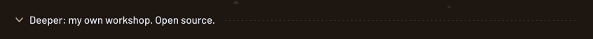
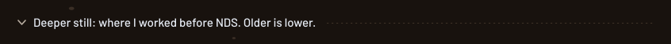
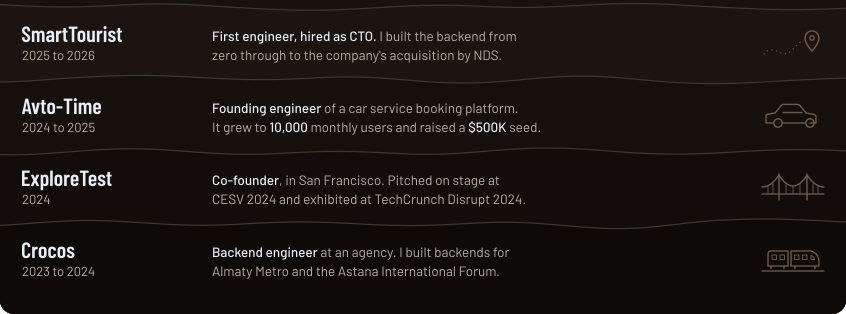

  <picture><source media="(max-width: 640px)" srcset="assets/phone-1.svg"></picture>
  <picture><source media="(max-width: 640px)" srcset="assets/phone-2.svg"></picture>
  <picture><source media="(max-width: 640px)" srcset="assets/phone-3.svg"></picture>
  <picture><source media="(max-width: 640px)" srcset="assets/phone-4.svg"></picture>
  <picture><source media="(max-width: 640px)" srcset="assets/phone-5.svg"></picture>
  <picture><source media="(max-width: 640px)" srcset="assets/phone-6.svg"></picture>
  <picture><source media="(max-width: 640px)" srcset="assets/phone-7.svg"></picture>

Text version

**Zhan Kuatuly.** Technical Lead at NDS. I run the backend of the AI assistant for a city of 2 million and lead the team behind the platform for its sports venues.

**The picture.** A cutaway: Almaty at night on top, and under the street the back end I build. Three things in it are counted. The sky has 2,553 stars, one for each test of Almaty Seasons. The city has 366 lit windows, one for each of its API endpoints. The Dastar hall has 5,000 dots, one for each request.

**Almaty Seasons** (NDS, private). The AI assistant for Almaty residents. I am its entire backend and infrastructure team.

- 366 API endpoints and 2,553 tests, built in 12 weeks as its only backend engineer
- An intent router picks 2 to 4 tools per request. Cutting that from 18 fixed tool calling in Kazakh.
- A 9B open model runs on our own GPU. The bottleneck was a prompt of about 11,800 tokens, not model size.
- Answers are checked against backend data.

**DSS** (NDS, private). One platform for Almaty's municipal sports venues: leasing, events, tickets, access control and analytics. As technical lead, I built the money path myself: seat hold with no double-sell, order, two-stage card capture, signed QR ticket.

- 46 days from the first commit to the first real ticket sale
- The card acquirer reports a declined payment as HTTP 200 with a false success flag. A callback that arrives twice is applied once.
- CI run time cut from 51 minutes to 2.5
- 10 people on the team I lead

**Arlan School** (NDS, private). School safety and education quality in one platform for Almaty schools, with video and audio analytics. Three levels, 10 roles:

- City and district: weekly indicators, a map of schools, AI analytics that leads to tasks for schools
- School: attendance checked against turnstiles, lesson analysis from recordings, cameras and safety events
- Classroom: AI Teacher, AI Tutor, AI Kitap and a quest room

**[Switchyard](https://github.com/Zhan017/switchyard)** (open source, Python). An LLM gateway. A provider dies mid-answer, and another model finishes the same stream.

- 6,000 of 6,000 requests completed with 30% of streams cut or stalled
- 1,306 broken streams, all finished on the second model
- 0.96 ms added at p95 before the first token, at 200 requests a second
- Measured against mock providers. Real APIs have had only a smoke test.
- More: [failover results](https://github.com/Zhan017/switchyard/blob/main/docs/results/scenarios-2026-10-30.md), [overhead results](https://github.com/Zhan017/switchyard/blob/main/docs/results/overhead-2026-10-29-4vcpu.md), [limitations](https://github.com/Zhan017/switchyard/blob/main/LIMITATIONS.md)

**[Dastar](https://github.com/Zhan017/dastar)** (open source, TypeScript and Postgres). A reservation engine. Double booking is refused by the database, not by application code.

- 4,999 of 5,000 requests for one table refused. One gets it and none overlap. Run the race: `docker compose run --rm demo`
- The usual way, a plain check-then-insert, double-books 1,225 pairs with only 50 clients.
- 12 invariants enforced by Postgres, with 843 tests, most against a real Postgres 18
- For AI agents: an MCP server with 4 tools. Agents hold, people confirm.
- An audit checks an agent's claims against what its recorded calls returned.
- More: [correctness table](https://github.com/Zhan017/dastar/blob/main/CORRECTNESS.md), [benchmarks](https://github.com/Zhan017/dastar/blob/main/BENCHMARKS.md), [limitations](https://github.com/Zhan017/dastar/blob/main/LIMITATIONS.md), [agent tools and audit](https://github.com/Zhan017/dastar#agent-tools-and-mcp)

**Before NDS**

- SmartTourist, 2025 to 2026. First engineer, hired as CTO. I built the backend from zero through to the company's acquisition by NDS.
- Avto-Time, 2024 to 2025. Founding engineer of a car service booking platform. It grew to 10,000 monthly users and raised a $500K seed.
- ExploreTest, 2024. Co-founder, in San Francisco. Pitched on stage at CESV 2024 and exhibited at TechCrunch Disrupt 2024.
- Crocos, 2023 to 2024. Backend engineer at an agency. I built backends for Almaty Metro and the Astana International Forum.

**Contact.** [LinkedIn](https://www.linkedin.com/in/zhan-kuatuly)

